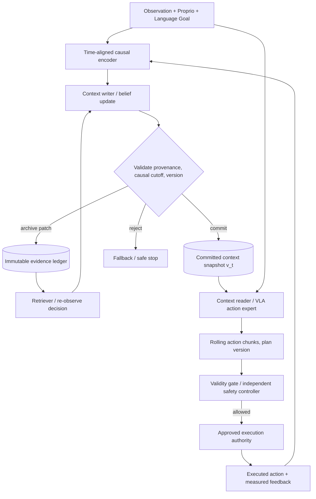

# 04 | System architecture and contracts

## System view



## One cognition, multiple rates

1. **Fast belief update**: lightweight per-observation or event update of contact/object state, with known timestamps.
2. **Task-context commit**: bounded context tokens/structured propositions on action chunk or event transitions; atomic snapshots.
3. **Episodic store**: indexed evidence with hashes and immutable references, asynchronous long-range consolidation.
4. **Action expert**: retains existing pretrained VLA and rolling chunk mechanism. Context adapter is frozen/off by default until validated.
5. **Safety controller**: no ML module can bypass the physical controller's timing/constraints.

## Proposed core package boundaries

- `contracts`: versioned Observation, ExecutedAction, EvidenceRef, ContextState, MemoryPatch, PlanRef.
- `evidence`: append-only episode ledger, IDs, timestamps, immutable payloads, source hashes, retention policy.
- `encoder`: pretrained visual/proprio + optionally language embeddings, inference-only normalizers.
- `state`: learned object/interaction belief with unknown flags and confidence (calibrated on validation).
- `memory`: bounded working context, key/value slots, semantic state and cold external store.
- `controller`: operations (WRITE, UPDATE, ABSTRACT, EVICT, RETRIEVE, VERIFY, PIN) with deadline and utility estimates.
- `reader`: Policy cross-attention / conditioning adapter; explicit use/ablation hooks.
- `flow_adapter`: model-specific OpenPI/other inference plugin; no direct source vendoring.
- `executor`: rolling chunk plan gate, timestamps, version invalidation, safe fallback.
- `eval`: deterministic replay, paired-history intervention, OOD and statistical aggregators.

## API sketches

```
Observe(episode_id, timestamp_ns, camera_bytes_refs, proprio, measured_signals)
CommitPatch(base_version, causal_cutoff_ns, operations[], evidence_refs[]) -> Snapshot
RequestContext(snapshot_version, goal, budget, deadline_ns) -> ContextTensor + Diagnostics
PredictAction(obs, context_version, context_tensor, previous_executed_prefix) -> ActionPlan
ValidatePlan(plan, current_version, safety_constraints, executed_prefix) -> allow/replan/reject
RecordExecution(plan_id, commanded_action, measured_action, timestamps) -> EvidenceEvent
```

## State schema

A context snapshot consists of `episode_id, version, committed_at_ns, cutoff_ns, goal_revision, schema_version, fast_belief, task_state, identity_map, memory_slots, evidence_refs, uncertainty, safety_constraints`. All fields carry typed semantics; `measured`, `inferred`, `hypothesized`, `predicted`, `verified` must not be conflated. Raw frames do not need to be serialized into hot context.

## Concurrency

- **One writer per episode** commits new `context_version` using compare-and-swap.
- Encoder and retrieval can run concurrently; their output must declare observation cutoff; late output cannot replace newer snapshot.
- Policy reads a consistent immutable snapshot, never half-written memory.
- When a context commit materially alters objects, task goal or safety state, mark existing rolling suffix stale and force safe replan; minor unrelated updates may retain plan only under an explicit proof/guard.
- No in-flight control waits for cold storage I/O unless required for safety; in that case hold/safe stop.

## Control requirements

Measure `T_sensor`, `T_encode`, `T_memory`, `T_policy`, `T_queue`, `T_execute`. Respect actual robot control cycle and p95 deadlines. GPU streams/microbatch may help, but never assume parallelism makes latency free. Distinguish command issue from physical execution result; no future-label leakage.

## First implementation

P1 uses bounded structured event memory + latent slots and fixed reader. P2 adds future-value utility. P3 adds learned management and active recovery. Avoid generic agent frameworks, multiple databases or unreviewed online LLM dependencies in the real-time path.

## Explicit non-goals (v1)

- Replacing the entire pretrained VLA with new backbone.
- Replicating CLM's unrestricted shell-based file editing on the robot control process.
- Adding a large external VLM planner to every control tick.
- Claims of exact belief-state recovery or lossless compression.
- Cloud connection or remote motion authority from the model.
