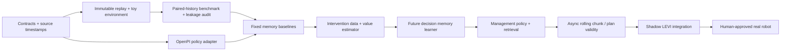

# 09 | Engineering backlog with dependency graph and definition of done

## Engineering principle

Keep research code small, layered and reversible. No monorepo rewrite; no giant `utils.py`; no mixing LeRobot/LEVI/DROID tensor conventions in one class; no ad hoc environment imports. All 3rd-party adapters are optional and version-pinned.

## Dependencies

## Milestones

### M0 — Research infrastructure (delivered in this archive)
- [x] Research documents and explicit novelty collision register.
- [x] Skeleton Python package and toy context contracts.
- [x] CPU smoke tests, static fake environment and dry-run.
- [x] SLURM templates guarded by required environment variables.
- [ ] Inspect local GPU/cluster/camera/robot access (requires operator).

### M1 — Data & causality  (DoD checklist 2026-11-12 in `STATUS.md`: open = LeRobot importer, image-level audit, full benchmark adapter; status 2026-11-11: **implemented on CPU, partially meets DoD**)
- Implement standardized episode schema + HDF5/LeRobot importers and time validation.
- Create SODH paired generator, split manifest, negative controls, image-only shortcut audit.
- DoD: deterministic replay with no future information at any cutoff; duplicate detector passes; one benchmark adapter usable.

**Post-review amendment (2026-11-11, `docs/18`):** G0 was extended to audit the full decision view (g0/2) after an independent-context review showed five leaks passing g0/1; SODH v1 is frozen as a *test fixture*, not scientific evidence; SODH v2 (spec in `docs/18`) is required before M3. **M1 DoD remains open** (see unresolved list below).

**Delivered (all `mode: synthetic`, symbolic frames; plan in `TASK_PLAN.md`):**
- [x] `episode.py`: `EpisodeRecord` schema v1, multi-camera/time-aligned frames, commanded vs executed vs (never stored) predicted actions, source types, hash-bound frames/events, `CausalView` + deterministic `replay()` (I1).
- [x] `alignment.py`: integer clock-domain maps, causal sample-and-hold with staleness bound, order-independent merge; unknown clock domain is an error.
- [x] `sodh.py`: deterministic generator (version-independent keyed RNG), 3 history-relevant families + 1 `irrelevant_history` control, regimes `in_dist` / `ood` (longer horizon) / `heldout_mapping` (unseen object vocabulary), planted-leak modes for auditor tests only.
- [x] `splits.py`: pair-level assignment, checker (pair/script/content/mapping leakage, OOD ordering, label balance), content-addressed write-once split manifest `sodh-split-c57fb89bf0a3`.
- [x] `audit.py`: pair validity, observation-only cap, within-pair structural diffs, metadata lookup, id-leak scan, history-swap, **executable G0** (`scripts/audit_sodh.py` exits 1 on failure).
- [x] `adapters.py`: `BenchmarkAdapter` protocol, usable `SODHAdapter`, paired evaluation; explicit status registry (`ADAPTER_STATUS`).
- [x] `baselines.py`: Memoryless / FullHistory / LongWindow(k) / UniformSubsample(k) symbolic readers under a matched hot-tick budget; `stats.py` Wilson + cluster bootstrap.
- [x] `dataset_io.py`: canonical JSONL, hash-verified read, write-once data; `results/synthetic/sodh_v1/` (704 episodes, 352 pairs; 264 history-relevant pairs).
- [x] Tests: 63 (12 pre-existing, unchanged) incl. hypothesis property tests; ruff clean.

**Observed (synthetic, not a research result):** G0 PASS. Memoryless pair-both-correct = 0 on all relevant families (structural); FullHistory = 1.0; fixed-budget windows degrade on `test_ood`. Planted leaks (`length`, `id`, `final_obs`) each make G0 FAIL, so the auditor is not vacuous. Finding: the metadata *lookup* audit does not detect the `length` leak (episode lengths vary across pairs); the within-pair structural diff does — keep both.

**Unresolved / not done:**
- HDF5/LeRobot importers and a real-benchmark adapter (RoboMME etc.): **not implemented** (dataset + license review pending, `docs/15`). "One benchmark adapter usable" is met only by the symbolic SODH adapter.
- LEVI event bridge: **deliberately not implemented** — operator advised against LEVI adaptation (2026-11-11); this deviates from the M1 text in the master prompt. `docs/13` remains a proposal.
- Image-level / perceptual shortcut and dedup audits: planned (symbolic frames have no pixels). `state_uncertainty` SODH family: planned for M4.
- `test_id` has only 36 pairs (9 per family); bootstrap CIs are wide. Counts are an engineering sanity target, not a power analysis (`docs/06`).
- Directory is not a git repository: provenance uses `code_tree_sha256`; `git init` + first commit recommended before M2. System Python 3.14 is outside `pyproject` range; a uv-managed 3.12 `.venv` was used.
- Only self-review so far; no independent reviewer sign-off (`docs/14`). No G1+ gate evaluated.
- Mechanical lint-only edits to pre-existing `contracts.py`/`memory.py`/`toy.py` (unused import, `collections.abc`, `min()`); behaviour and tests unchanged.

### M2 — Fixed baselines + VLA reader  (DoD checklist in `STATUS.md`; round 2 added SODH v2, posterior oracle, memory metrics, F7/F8 — M2 DoD still NOT met; status 2026-11-11: **CPU-only infrastructure implemented; M2 DoD NOT met**)

**Delivered (CPU, synthetic; contract in `docs/17`):** `context.py` (budgeted providers + harness-side validation), `policy.py` (PolicyAdapter, access boundary), `readers.py` (OracleDecoder strict/clock, ObsOnlyLookup, BagOfTokensNB), `harness.py` (single evaluation path, train-only fitting, predicted→commanded→executed logging), `causal_eval.py` (history swap, critical vs matched non-critical deletion, coverage/evidence-position), `stattests.py` (exact sign test, Holm), `runrecord.py` + `scripts/run_m2_eval.py` + `scripts/repro_check.py` (real git SHA, data/config hashes, fresh-process reproducibility, evaluation ledger), `benchmark_contract.py` (source conformance; HDF5/LeRobot importers raise `NotImplementedError`).

**Not done / blocked:** OpenPI adapter and any real VLA (no checkpoint/licence/GPU authorisation); D&R/Mem4Act reproduction; fixed-latent learned baseline; RoboMME or any real-data importer (licence/data approval, `docs/16 (withheld from the public release)`); SODH v2 (needed before any comparative memory claim). The M2 DoD sentence "intervention changes policy on SODH" is met only for hand-written decoders, which is a decoder self-check, not a result.

(original M2 text follows)

- Reproduce Memoryless, uniform, full history, fixed latent; D&R/Mem4Act when released/compatible.
- Implement one OpenPI checkpoint adapter with original action normalization and camera layout.
- DoD: exact checkpoints/config fingerprints, smoke eval, training trace and matched costs; intervention changes policy on SODH.

### M3 — Decision-utility learner
- Resettable simulator paired-rollout executor; item-group interventions, common random seeds, utility estimator, calibration.
- DoD: external held-out intervention error, confidence interval, compare salience/Mem4Act/D&R; no train-test leakage.

### M4 — Adaptive manager
- WRITE/UPDATE/ABSTRACT/EVICT/RETRIEVE/VERIFY/PIN controller; learning objective and cost constraints.
- DoD: all operations causal and versioned, memory budget enforced, corrupt/incomplete memory handled explicitly.

### M5 — Rolling integration + system
- PlanRef, chunk continuation invalidation, async snapshots and p95 latency measurements.
- DoD: no actuation from model code; stale plans rejected in tests; p95 at operator-defined deadline; deadline misses logged.

### M6 — Main research evaluation
- Locked seeds, full ablations, uncertainty, bootstrap, OOD and recovery tests, raw videos/metrics.
- DoD: pre-registered H1-H4 adjudication incl. negative results, artifact manifest ready.

### M7 — Real world + publication
- Operator safety signoff; shadow mode; restricted real robot; final manuscript and reproducibility audit.
- DoD: human-approved and documented hardware tests; paper claim matrix grounded in results.

## Milestone PR checklist

- What prior work and protocol does this change implement?
- Does it create train/test leakage or privileged online information?
- Is there a minimal unit test, adversarial test and a negative control?
- Are time alignment, versioning, action feedback and safety preserved?
- Are performance numbers from actual runs with config/commit fingerprints?
- What did the result falsify, and is the result reproducible?

## Non-negotiable engineering constraints

No silent edits to splits or benchmark logic. Never keep GPU allocated for idle jobs. Use explicit bounded queues and async expiration. Try high-level import isolation. No runtime download of mutable main branches. No caching that shares observations across episodes.
